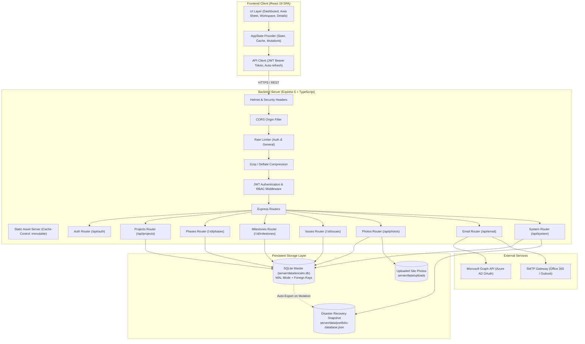
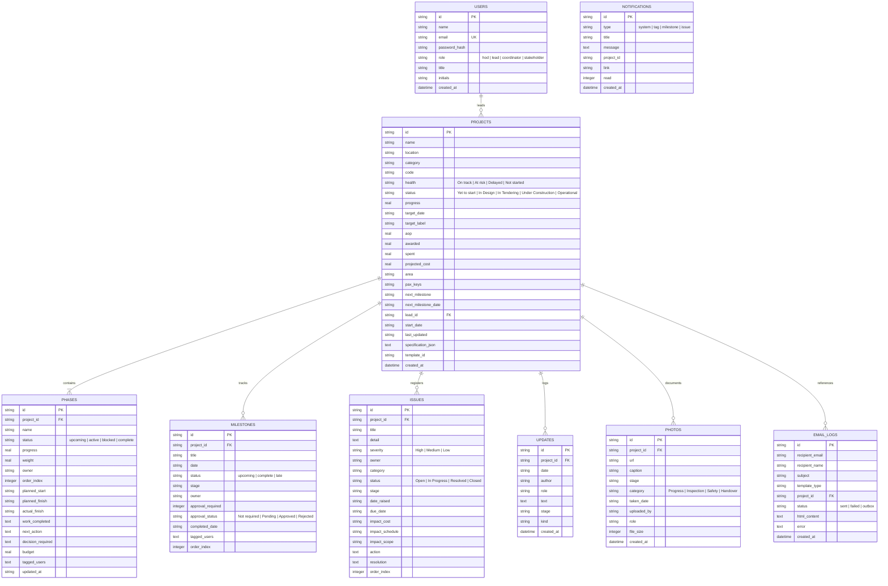
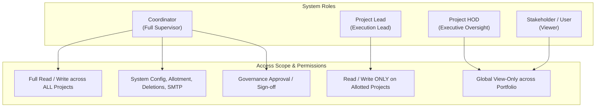

# System Architecture: Encalm Project Dashboard

This document details the architectural design, data flow, components, database structure, and integration patterns powering the **Encalm Project Dashboard**.

---

## 1. High-Level System Architecture

The Encalm Project Dashboard is an enterprise-grade full-stack project governance and portfolio management platform built with modern web technologies:

- **Frontend Client**: React 19 Single Page Application (SPA) powered by Vite 7, Tailwind CSS v4, Radix UI primitives, Lucide icons, and Recharts.
- **Backend API Server**: Node.js & Express 5 running with TypeScript, Helmet security headers, Gzip compression, and rate limiting.
- **Database Engine**: Embedded SQLite 3 (`better-sqlite3`) in Write-Ahead Logging (`WAL`) mode with foreign key constraints and memory query caching.
- **Notification Services**: Dual email engine supporting direct SMTP (Office 365 / Exchange) and Azure AD Microsoft Graph API (OAuth 2.0 client credentials).

---

## 2. Architectural Single Source of Truth (SSOT)

> [!IMPORTANT]
> **Authoritative Master**: The SQLite database file (`server/data/encalm.db`) is the canonical, live single source of truth for all project records, stages, milestones, issues, photos, updates, email logs, and authentic user identities.

### Secondary Artifacts
- **Disaster Recovery Snapshot (`server/data/portfolio-database.json`)**:
  - An asynchronous, point-in-time JSON snapshot generated automatically upon data-mutating operations.
  - Used strictly for cold-start disaster recovery (if the SQLite DB file is ever missing) or offline data export.
  - Snapshot files never overwrite live database records during normal server operations.
- **Client Cache**:
  - Browser memory and query caches are treated strictly as read-through caches. All data writes must commit synchronously to the SQLite database.

---

## 3. Database Schema (Entity-Relationship Diagram)

---

## 4. Role-Based Access Control (RBAC) Architecture

The authorization model separates responsibilities across four distinct tiers:

### Authorization Rules Matrix
1. **Coordinator**:
   - Create, allot, edit, and delete any project.
   - Configure email gateways (SMTP & Azure Graph credentials).
   - Sign off or reject governance milestones.
   - Run system data imports/exports.
2. **Project Lead**:
   - Create new projects (automatically allotted to the creating Lead).
   - Add/edit/delete stages, milestones, issues, photos, and updates within their own allotted projects.
   - Cross-project modifications to other Leads' projects are blocked (`403 Forbidden`).
   - Project deletion and allotment changes are prohibited.
3. **Project HOD**:
   - Global read-only portfolio access.
   - All server mutations (`POST`, `PATCH`, `DELETE`) are strictly forbidden (`403 Forbidden`).
4. **Stakeholder / Directory Users**:
   - Read-only viewing and inclusion in notification mention tags.

---

## 5. Email Notification & Dispatch Engine

The email system employs a dual-provider architecture configured in [`server/src/services/email.ts`](file:///c:/Users/DigitalIntern/Downloads/Project-Dashboard-main%20(3)/Project-Dashboard-main/server/src/services/email.ts):

1. **Microsoft Graph API (Azure AD OAuth 2.0)**:
   - Uses client credentials flow (`tenantId`, `clientId`, `clientSecret`) to acquire bearer tokens from `https://login.microsoftonline.com/{tenantId}/oauth2/v2.0/token`.
   - Sends HTML emails via `https://graph.microsoft.com/v1.0/users/{senderEmail}/sendMail`.
   - Enables live enterprise directory auto-completion (`/api/email/directory?q=`).
2. **Standard SMTP**:
   - Nodemailer transport targeting Office 365 (`smtp-mail.outlook.com:587`, STARTTLS) or internal SMTP relays.
3. **Offline / Unconfigured Fallback (Email Outbox)**:
   - If neither provider has valid credentials, email notifications are not dropped.
   - They are recorded in the `email_logs` table with status `outbox` for audit trail inspection and manual resend once credentials are saved.

---

## 6. Photo Storage & Processing Pipeline

1. **Upload Input**: Client accepts multiple images (drag-and-drop or file picker) and converts them to base64 Data URIs.
2. **MIME Validation & Extension Whitelisting**:
   - The server validates the format against `ALLOWED_IMAGE_EXTENSIONS = ['jpg', 'jpeg', 'png', 'webp', 'gif']`.
   - Rejects non-image files, executable extensions, and unvalidated blobs.
3. **Storage**:
   - Photos are written to disk under `server/data/uploads/{projectId}_{timestamp}_{randomSuffix}.{ext}`.
   - Paths are stored relationally in SQLite `photos` table.
4. **Delivery & Caching**:
   - Express static handler serves `/uploads` with 1-day browser cache headers (`maxAge: 86400000`).
   - On project deletion, all associated disk files in `uploads/` are unlinked automatically to avoid orphaned disk consumption.

---

## 7. Resilience, Lifecycle & Graceful Shutdown

The backend process implements signal management:

1. **`SIGTERM` / `SIGINT` Handling**:
   - Stops HTTP server from accepting new incoming connections.
   - Allows in-flight HTTP requests to complete cleanly.
   - Executes `PRAGMA wal_checkpoint(TRUNCATE)` to flush WAL journal files into the main database file.
   - Exports a disaster-recovery JSON snapshot to `server/data/portfolio-database.json`.
   - Safely closes the SQLite database connection (`db.close()`).
   - Exits process with code 0.
2. **Fatal Exception Containment**:
   - `uncaughtException` and `unhandledRejection` handlers log structured diagnostic traces and initiate graceful cleanup to prevent data corruption.
