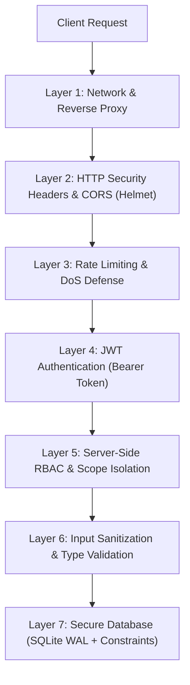

# Security Policy & Architecture: Encalm Project Dashboard

This document details the security principles, authentication mechanisms, authorization boundaries, threat protections, and vulnerability reporting procedures for the **Encalm Project Dashboard**.

---

## 1. Security Architecture & Threat Model

The dashboard implements defense-in-depth across the application lifecycle:



---

## 2. Authentication & JWT Token Model

1. **Token Generation**:
   - Authentication tokens are generated using JSON Web Tokens (`jsonwebtoken`) signed with a server secret (`JWT_SECRET`).
   - Tokens contain user ID, name, email, and role.
   - Tokens expire after 7 days (`expiresIn: '7d'`).
2. **Production Secret Enforcement**:
   - In production (`NODE_ENV=production`), the application strictly checks if `JWT_SECRET` is defined in the environment.
   - A critical security warning is logged if the default development secret is detected.
3. **Password Storage**:
   - Passwords for local user accounts are hashed using `bcryptjs` with 10 salt rounds (`bcrypt.hashSync(password, 10)`).
   - Plaintext passwords are never stored in the database or emitted in API payloads.

---

## 3. Server-Side Role-Based Access Control (RBAC)

Authorization is enforced on the server for all data-changing operations (`POST`, `PATCH`, `DELETE`):

| Role | Permissions & Scope Boundaries |
| :--- | :--- |
| **Coordinator** | Full supervisory permissions across all projects, project allotment (`/allot`), project deletion (`DELETE`), bulk synchronization (`/sync`), and email configuration (`/api/email/settings`). |
| **Lead** | Can create new projects (automatically allotted to them). Can edit, add stages, log issues, track milestones, post updates, and upload photos **only for projects allotted to them** (or unassigned projects). Cross-project edits and deletions are rejected (`403 Forbidden`). |
| **HOD** | Executive oversight. Strictly read-only access. Any data-changing requests are rejected with `403 Forbidden: HOD role has strict view-only oversight`. |
| **Anonymous** | Unauthenticated callers without a valid Bearer token are rejected with `401 Unauthorized: Authentication token is required`. |

### Project Ownership Enforcement (`requireProjectAccess`)
Every project-scoped route extracts the project ID and verifies ownership via `canUserEditProject()`:
- Missing projects return `404 Not Found`.
- Unauthorized roles return `403 Forbidden`.
- Tokenless requests return `401 Unauthorized`.

---

## 4. Network Hardening, Rate Limiting & HTTP Headers

1. **Helmet HTTP Headers**:
   - `X-Content-Type-Options: nosniff` (prevents MIME-type sniffing).
   - `X-Frame-Options: SAMEORIGIN` (guards against clickjacking).
   - `X-XSS-Protection: 0` (modern standard per OWASP guidelines).
   - `Referrer-Policy: strict-origin-when-cross-origin`.
2. **CORS Isolation**:
   - In production, cross-origin requests are restricted to domains declared in `CORS_ORIGIN`.
   - Wildcard origins are disabled in production.
3. **Endpoint Rate Limiting (`express-rate-limit`)**:
   - **Global API**: 600 requests per 15 minutes per IP.
   - **Login Endpoint (`/api/auth/login`)**: 30 attempts per 15 minutes per IP to prevent credential brute-forcing.
   - **Email Dispatch (`/api/email/test`, `/tag-and-comment`)**: 100 emails per 15 minutes per IP to prevent spam abuse.

---

## 5. Input Validation & Media Upload Security

1. **Allowed Image Whitelist**:
   - Photo uploads are restricted strictly to `['jpg', 'jpeg', 'png', 'webp', 'gif']`.
   - Executable, script, HTML, or SVG files with embedded scripts are rejected.
2. **Path Traversal Protection**:
   - Upload file names are generated server-side using sanitized project slugs and cryptographic random suffixes:
     ```ts
     const safeProjectId = (projectId || 'project').replace(/[^a-zA-Z0-9-_]/g, '');
     const newFileName = `${safeProjectId}_${Date.now()}_${randomSuffix}.${safeExt}`;
     ```
   - Direct user-supplied file names are never used for disk paths.
3. **Payload Size Limits**:
   - JSON body parsing is restricted to 50MB to accommodate multi-photo batches while mitigating memory exhaustion DoS attacks.

---

## 6. Destructive System Safeguards

- High-impact maintenance endpoints (`/api/system/reset`, `/clear`, `/import`, `/restore-all-pdfs`):
  - Strictly restricted to Coordinator role (`requireAuth` + `requireRole(['coordinator'])`).
  - In production (`NODE_ENV=production`), database resets are disabled unless `ALLOW_SYSTEM_RESET=true` is explicitly set in the server environment.

---

## 7. Reporting a Vulnerability

If you discover a security vulnerability in this project:

1. **Do not open a public GitHub issue**.
2. Email details directly to the Encalm IT Security Team at:
   - **Email**: `security@encalm.com` or `dev@encalm.com`
3. Include:
   - Description of the vulnerability.
   - Steps or proof-of-concept to reproduce.
   - Potential impact.
4. The team will acknowledge receipt within 48 hours and work with you on remediation before any public disclosure.
